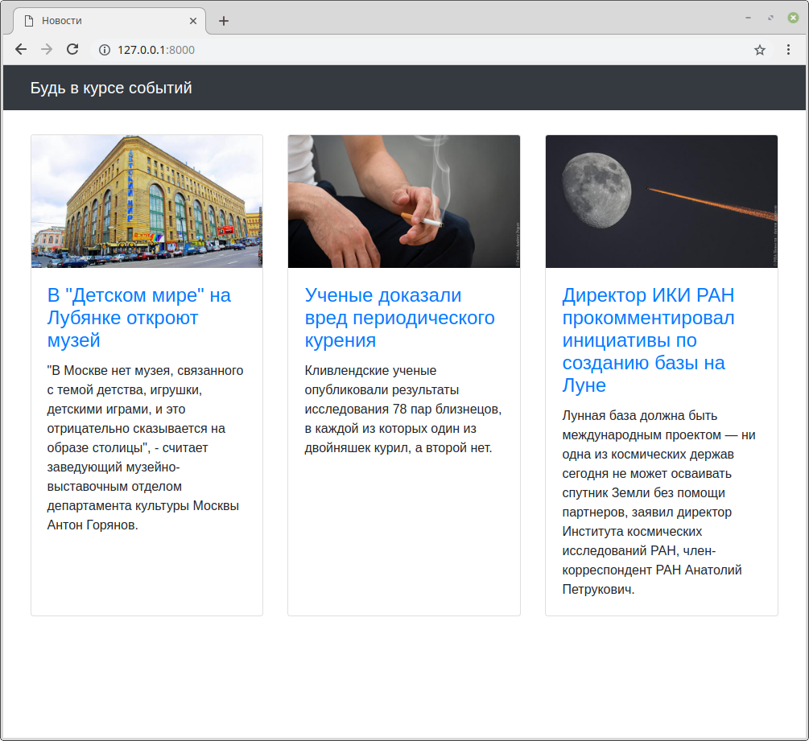
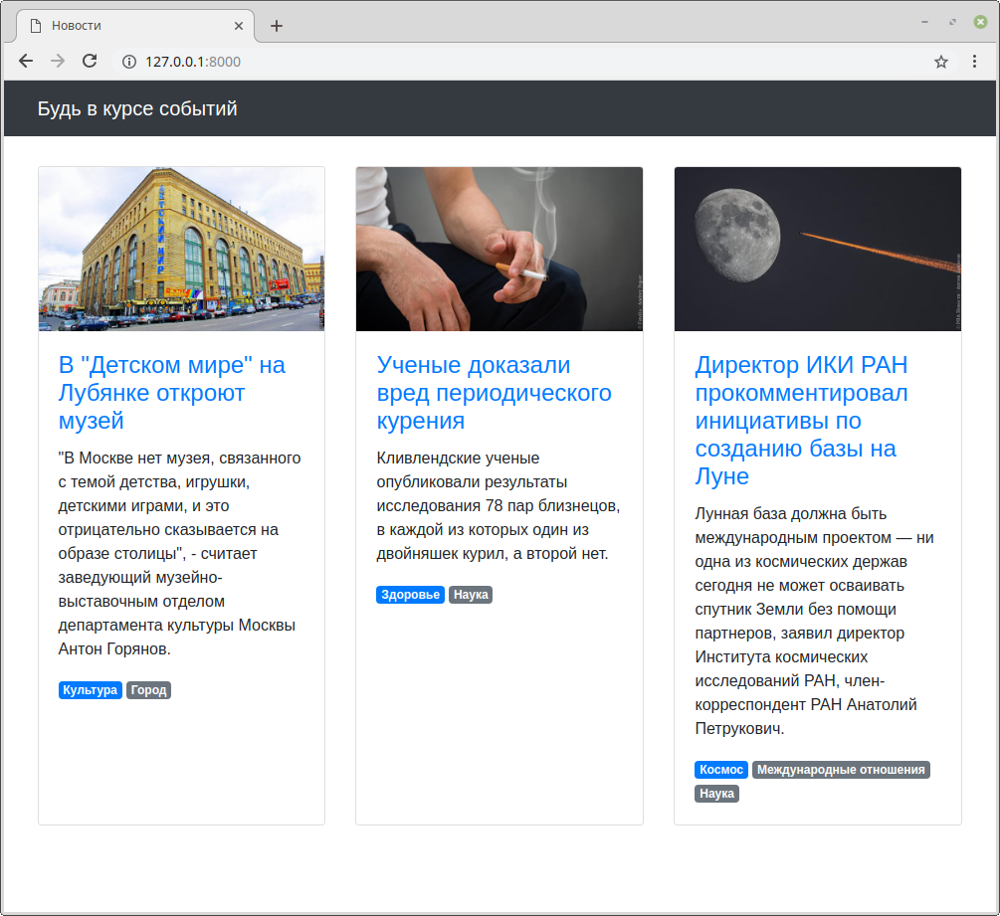
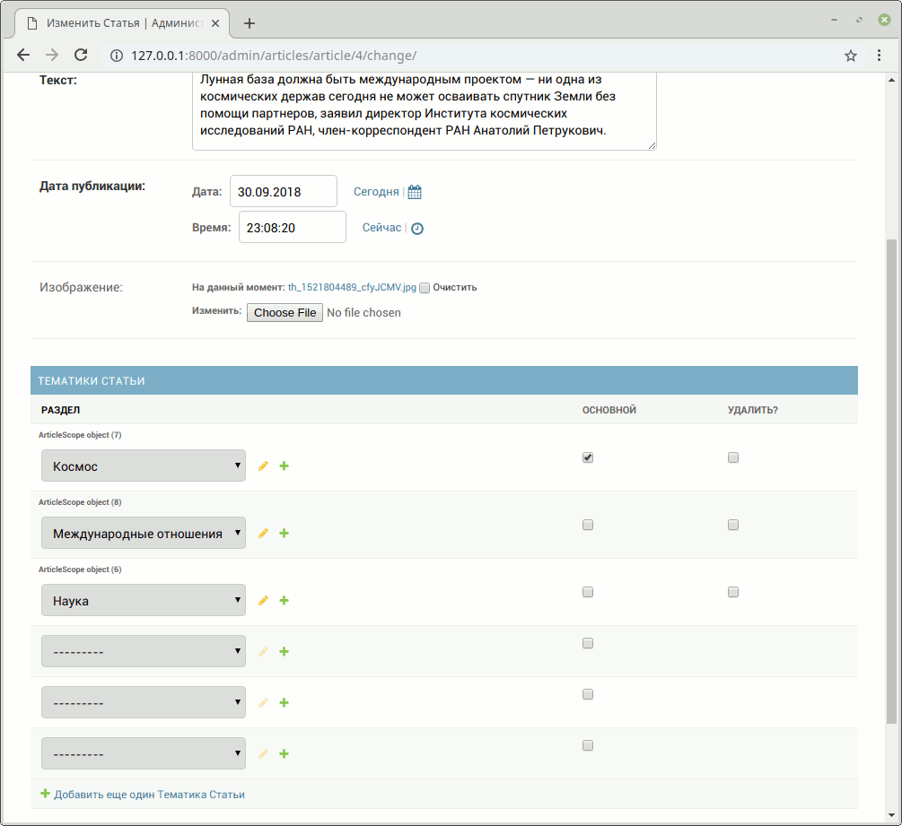

## Задание

Есть небольшой новостной сайт.



Было решено к статьям добавить тематические резделы, к которым они относятся, и отображать их у каждой новости в виде списка тегов.



У каждой статьи может быть несколько разделов, но всегда один из них должен быть основным.
В списке тегов он должен идти первым, потом все остальные в алфавитном порядке.

В админке необходимо реализовать создание разделов и для страницы _Редактирование статьи_ добавить возможность указывать разделы.
Необходимо также реализовать проверку на наличие одного и только одного основного раздела.



## Примечание

* `Tag` — просто тег, только его название, ничего более;
* `Article` — статья с текстом, заголовком, картинкой и пр. + набор тегов (многие ко многим);
* `Scope` — таблица-связка между статьей и тегом. Именно здесь должно быть свойство `is_main`.

## Что реализовано
 
* **Модели** (`articles/models.py`):
  * `Tag` — раздел (название).
  * `Article` — статья.
  * `Scope` — связка `Article` ↔ `Tag` с полем `is_main`; сортировка
    `['-is_main', 'tag__name']` даёт нужный порядок тегов в шаблоне.
* **View** (`articles/views.py`) — статьи передаются в шаблон через `object_list`,
  отсортированы по дате публикации.
* **Админка** (`articles/admin.py`):
  * `Tag` зарегистрирован отдельной моделью — можно создавать разделы.
  * `Scope` подключён инлайном к `ArticleAdmin` — разделы статьи редактируются прямо
    на странице статьи.
  * Кастомный `BaseInlineFormSet` (`ScopeInlineFormset`) проверяет при сохранении,
    что основной раздел выбран ровно один, иначе выводит ошибку.

## Документация по проекту

Для запуска проекта необходимо

Установить зависимости:

```bash
pip install -r requirements.txt
```

Настроить подключение к PostgreSQL в `settings.py` и указать пароль базы данных в переменной окружения `DB_PASSWORD`.

```powershell
$env:DB_PASSWORD = "ваш_пароль_от_postgres"
```

Применить миграции:

```bash
python manage.py migrate
```

Загрузить тестовые данные:

```bash
python manage.py loaddata articles.json
```

Запустить отладочный веб-сервер проекта:

```bash
python manage.py runserver
```
После запуска сайт доступен по адресу:

```text
http://127.0.0.1:8000/
```